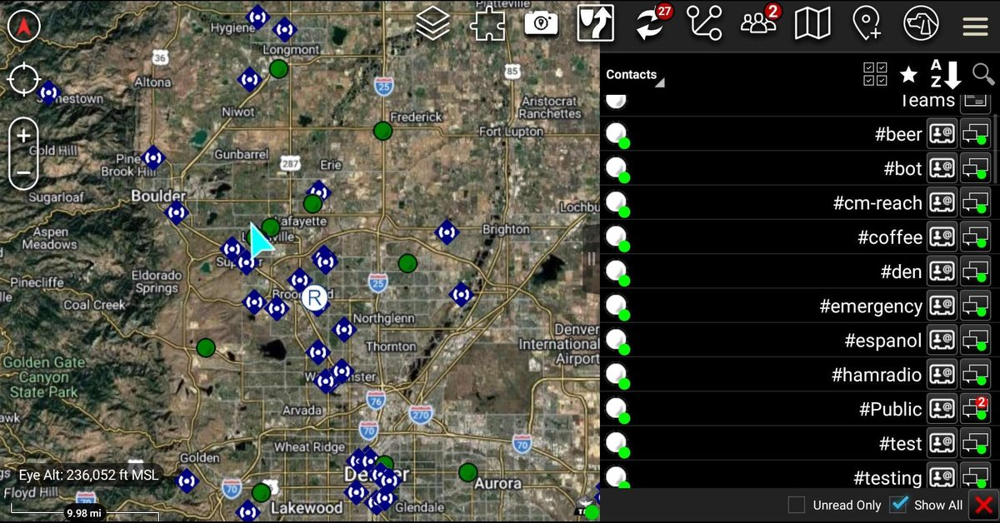
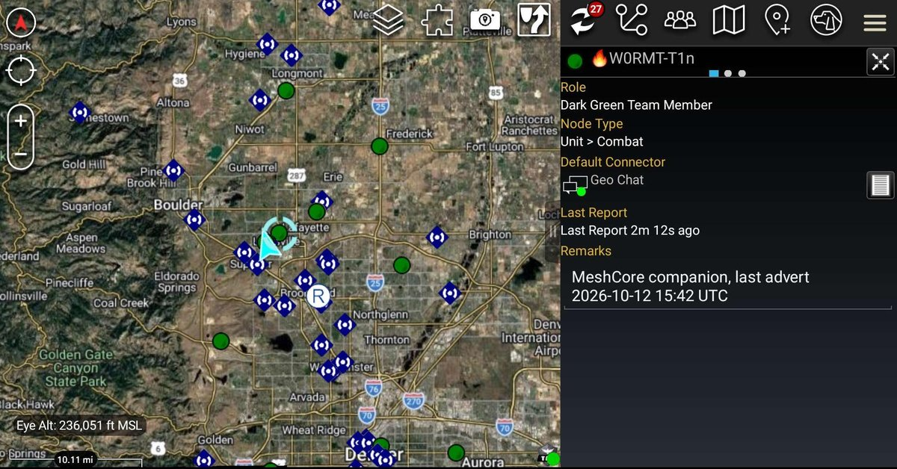
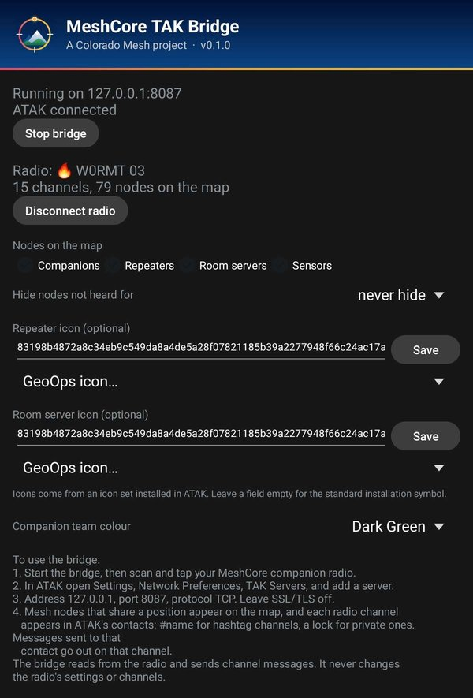

# MeshCore TAK Bridge

An Android app that connects a phone to a [MeshCore](https://docs.meshcore.io/) companion radio over Bluetooth and presents the mesh to [ATAK](https://tak.gov/) as a local TAK server. Mesh nodes appear as map markers, and each mesh channel appears as an ATAK contact you can chat with.

It is a [Colorado Mesh](https://coloradomesh.org/) project, and the phone-side counterpart to the TAK server in the [Colorado Mesh desktop client](https://github.com/Colorado-Mesh/mesh-client). How it works and why is in [docs/DESIGN.md](docs/DESIGN.md); what is done and what is next is in [docs/STATUS.md](docs/STATUS.md).

## Status

**Version 0.1.0, released 14 October 2026.** Tested on a Pixel 9 Pro and a Samsung Galaxy Tab Active 3. Download it from [Releases](https://github.com/Colorado-Mesh/meshcore-tak-bridge/releases).

What works:

- A local TAK server for ATAK on `127.0.0.1:8087`, plain TCP, loopback only, one client.
- A Bluetooth link to a MeshCore companion radio, with every step queued and time-limited, up to 3 connection tries, PIN pairing, and automatic reconnection to the radio chosen last time.
- Every node that shares a position as an ATAK marker: companions as team members in a team colour you choose, repeaters and room servers as installations (optionally with an icon from an ATAK icon set), sensors as sensors. Filters by node type and by how recently a node was heard.
- Every channel on the radio as an ATAK contact, two-way: channel text arrives as messages from that contact, and a message you send to it goes out on that channel.
- Direct messages with companion nodes, both ways, through each node's ATAK contact, with acknowledgement and up to 3 tries.
- Replies on a channel in MeshCore's `@[Name]` form, typed as `@` and the start of a name, or `@@` for whoever spoke last.
- Never writes to the radio's settings, channels, contacts or clock.

Not yet: the radio's battery in ATAK.

## Screenshots

ATAK on a Galaxy Tab Active 3 with the bridge running: mesh nodes along Colorado's Front Range, with repeaters as installations and companion radios as team members, and every channel on the radio as a contact at the top of the list.

<p align="center">
  
</p>

Selecting a companion node shows its details, including when it last sent an advert. Chat with it from its contact.

<p align="center">
  
</p>

The bridge app: what is connected, the radio, which nodes go on the map, and the icon and team colour settings.

<p align="center">
  
</p>

## Try it

1. Download `meshcore-tak-bridge-<version>.apk` from the latest [release](https://github.com/Colorado-Mesh/meshcore-tak-bridge/releases/latest). Later releases install over it and keep your settings. If you have a debug build from CI installed, uninstall it first: it is signed with a different key.
2. Install it on a phone that has ATAK, open it, and tap **Start bridge**. Allow Bluetooth and notification permissions when asked.
3. Tap **Scan for radios**, then tap your radio. Enter its PIN if Android asks to pair. The app remembers the radio and reconnects to it on its own.
4. In ATAK, open Settings, Network Preferences, TAK Servers, and add a server with address `127.0.0.1`, port `8087`, protocol TCP. Leave SSL/TLS off.
5. Mesh nodes with a position appear on the map. Each channel appears in ATAK's contacts, grouped at the top because every channel name starts with `#`: `#Public`, hashtag channels as MeshCore writes them (`#denver`), and private channels with a lock (`#🔒 SAR Team`). Open a channel's contact to chat on it. Messages you send to a channel contact go out over the radio under the radio's name. To reply to someone, start with `@` and the first part of their name (`@silver are you on?` goes out as `@[Silver Eagle] are you on?`), or `@@` to reply to whoever spoke last. If the start of the name fits several people, nothing is sent and the chat says who matched.
6. To message a person directly, open the contact of their companion node in ATAK and chat with it. Messages from them arrive the same way. A companion with no position appears in ATAK's contacts once a message has passed between you. Repeaters and room servers cannot be messaged.

Messages longer than the mesh allows are not sent: about 133 bytes on a channel, less the radio's name, and 160 bytes direct. The bridge says so in the chat instead. A direct message that is never acknowledged after 3 tries gets a note in its conversation.

If direct messages fail both ways while channels work, a radio probably holds a stale contact for the other. Each try is logged as "flooded", and no "Mesh, direct from" line ever appears. Send a flood advert from each radio so they re-learn each other's keys, then try again.

With no radio connected the bridge serves three demo markers in central Denver and a chat contact that echoes what you send, which is useful for checking the ATAK side alone.

### Checking a download

Every release is signed with the same Colorado Mesh key. Its certificate's SHA-256 fingerprint is

```
f59a5a05f3924b8e0dd2cc24aeb4f11405875d966d68bc25c2bbae9d38a7e554
```

(`F5:9A:5A:05:F3:92:4B:8E:0D:D2:CC:24:AE:B4:F1:14:05:87:5D:96:6D:68:BC:25:C2:BB:AE:9D:38:A7:E5:54` in `keytool`'s form). To check an APK, run `apksigner verify --print-certs meshcore-tak-bridge-<version>.apk` (from the Android SDK build tools) and compare the `certificate SHA-256 digest` line. Each release also lists the APK's own SHA-256.

### Test builds

Every push to `main` builds a debug APK, the `meshcore-tak-bridge-debug-apk` artifact on the [CI workflow's runs](https://github.com/Colorado-Mesh/meshcore-tak-bridge/actions/workflows/ci.yml). Debug builds are for testing: each is signed with a different temporary key, so uninstall the previous one (or the release) before installing another.

## Build and test

Requires JDK 17 (Gradle fetches it if missing) and, for the app, the Android SDK.

```bash
./gradlew test            # unit tests for the plain-Kotlin modules
./gradlew assembleDebug   # app/build/outputs/apk/debug/app-debug.apk
```

Every pull request and every push to `main` runs the tests and builds the debug APK in GitHub Actions. Signed releases are built from version tags; see [docs/RELEASING.md](docs/RELEASING.md).

## Contributing

Changes go into `main` through pull requests, and CI must pass before merging. Keep to the design rules below, and update [docs/STATUS.md](docs/STATUS.md) when something is finished, found on a device, or added to the to-do list. Bug reports, ideas, and reports of how the bridge does on your phone or tablet are welcome as [issues](https://github.com/Colorado-Mesh/meshcore-tak-bridge/issues/new/choose); each kind has a short form that asks for the details needed.

## Layout

| Module | Contents |
| --- | --- |
| `protocol` | MeshCore companion protocol: frame encoding and decoding, and the client that runs the conversation with the radio one command at a time. Plain Kotlin. |
| `cot` | The Cursor on Target events ATAK exchanges: markers, contacts, GeoChat, deletes, ping and pong, and the stream framer. Plain Kotlin. |
| `takserver` | The loopback TCP server: one client, keepalive replies, inbound chat, rate limit. Also a minimal web API answer on port 8080, so ATAK's poll for server contacts does not fail. Plain Kotlin. |
| `app` | The Android app: the Bluetooth link and scanner (`ble/`), the mesh-to-ATAK mapping (`MeshPicture`), the foreground service that ties them together, the status and settings screen, and the icons (`res/`). |

The plain-Kotlin modules have JUnit tests. The app is built in code with no layout resources; its only resources are the icons.

## Design rules

These come from problems seen in practice, and changes should keep to them.

- Never write to the radio's configuration: no channels, contacts, settings or clock.
- One Bluetooth operation at a time, and every operation has a time limit.
- Use every channel the radio reports, not a fixed number of slots.
- Send plain MeshCore channel text, readable by any MeshCore app.
- Channels and companions are ATAK contacts, not GeoChat rooms, so ATAK's replies say which channel or node they are for.
- Never send chat to a repeater or room server; they read admin text as commands.
- Listen on `127.0.0.1` explicitly, not Android's default loopback (`::1`).
- Events sent to ATAK are bare `<event>` elements with no XML declaration.

## Icon

The app icon is the Colorado Mesh mark, with its arc closed into a map crosshair, in the Colorado Mesh colours. It is drawn by [docs/icon/make_icon.py](docs/icon/make_icon.py), which writes the Android drawables and a preview, [docs/icon/icon.svg](docs/icon/icon.svg). It contains no ATAK or TAK artwork. The Colorado Mesh logo it is based on is by megabear (KD5IHC) and Johnny (W5KV), from [Colorado-Mesh/branding](https://github.com/Colorado-Mesh/branding).

## Licence

GPL-3.0-or-later. See [LICENSE](LICENSE).

This project is not affiliated with MeshCore, the TAK Product Center, or TAK-MESHCORE. It contains no code from TAK-MESHCORE.
