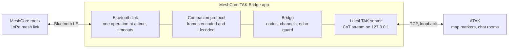

# MeshCore TAK Bridge: Design Proposal

11 October 2026

## Summary

MeshCore TAK Bridge is a proposed Android app that connects a phone to a MeshCore companion radio over Bluetooth and presents the mesh to ATAK as a local TAK server. ATAK connects to it the same way it connects to any server, so mesh nodes appear as map markers and mesh channels appear as ordinary ATAK chat rooms.

It is the phone-side counterpart to the TAK server built into the Colorado Mesh desktop client. That design is already working against ATAK, and this proposal reuses its behaviour.

The project is a new repository under Bud's GitHub account, written from scratch, with no code taken from TAK-MESHCORE. It is licensed GPL-3.0-or-later, the same as the Colorado Mesh desktop client. If it proves itself and the Colorado Mesh maintainers agree, the repository can move into that organisation.

## Background

There are two ways to get MeshCore into ATAK today, and each leaves a gap.

| Option | What it does well | Where it falls short |
| --- | --- | --- |
| Colorado Mesh desktop client, TAK server | One radio serves every ATAK device on the network; channels become chat rooms; nodes become markers | Needs a computer running the client and a shared network, so it does not work for a lone phone in the field |
| TAK-MESHCORE plugin | Phone connects straight to its own radio, no server | See the list below |

Problems seen with the TAK-MESHCORE plugin (v1.5.14), from use and from reading its source:

- It fails to connect on a Samsung Galaxy Tab Active 3 and sits on "Connecting" indefinitely. The connect code starts two Bluetooth operations at once and has no timeout.
- It reads only channel slots 0 to 7, although the radio reports how many it supports.
- It writes its own channel, `ATAK_DATA`, into slot 7 of the radio on every connect, and the channel stays there after disconnect.
- Channel chat lives in a cramped panel inside the plugin, not in ATAK's chat screen.
- It is built for ATAK 5.6.0 only, and an ATAK plugin has to be rebuilt as ATAK changes.
- It has no automated tests in about 36,000 lines of code.

A bridge app avoids the last two by design: it speaks only the standard TAK server protocol, so it is not tied to an ATAK version and needs no plugin signing.

## Goals and non-goals

The first version does three things well and leaves the rest out.

**Goals for version 1**

- Connect reliably to a MeshCore companion radio over Bluetooth on a range of Android devices, including older Samsung tablets.
- Show every mesh node that advertises a position as an ATAK map marker, styled by what it is: companion, repeater, room server or sensor.
- Show every channel on the radio as an ATAK chat room, two-way, using ATAK's own chat screen.
- Send and receive plain MeshCore channel text, readable by anyone on the mesh with any MeshCore app.
- Never change the radio's configuration. No channels are written, and nothing is left behind after disconnect.
- Work with any current ATAK version without being rebuilt.

**Not in version 1**

- Sending ATAK map points, routes or drawings between ATAK users over the mesh. This is what TAK-MESHCORE's `ATAK_DATA` tunnel does, and it is the main source of that plugin's complexity and airtime use.
- Direct messages. Planned for a later version, once channel chat is solid.
- Its own encryption layer. MeshCore channels are already encrypted with the channel key.
- Meshtastic or Reticulum support.
- iPhone support. iTAK cannot be served this way from an Android app.
- Anything inside ATAK's interface: no custom tools, menus or buttons. That would need a plugin.

## Architecture

The app sits between the radio and ATAK on the same phone, and each of its four parts has one job.

Data flows both ways along the same path. Radio frames come in over Bluetooth, are decoded, and update the bridge's picture of nodes and channels; the bridge turns changes into CoT events for ATAK. A chat message typed in ATAK travels the other way and leaves the radio as a channel message.

The bridge in the middle is the only part that holds state, and it is the part shared in design with the Colorado Mesh desktop client.

## Radio link

The app talks to the radio with the published [MeshCore companion protocol](https://docs.meshcore.io/companion_protocol/) over Bluetooth Low Energy. The radio exposes a serial-style service with one characteristic the app writes to and one it receives notifications from; each write or notification carries exactly one protocol frame.

The connection follows the sequence the protocol documents:

1. Connect, discover the service, and turn on notifications.
2. Send app start, then device query. The reply gives the firmware version and the number of channels and contacts the radio supports.
3. Set the radio's clock, fetch contacts, and fetch each channel slot up to the number the radio reported.
4. Fetch any waiting messages, then listen for the "messages waiting" and advert notifications.

Rules the Bluetooth layer follows, each chosen to avoid a failure seen in TAK-MESHCORE:

- **One operation at a time.** Every Bluetooth request and every protocol command goes through a single queue and waits for its result before the next starts. The larger packet size is requested first, and service discovery starts only after that request finishes.
- **Everything has a timeout.** A connect attempt, a pairing prompt or a command that gets no reply fails with a message the user can act on. The protocol suggests about 5 seconds per command.
- **Read-only towards the radio's settings.** The app sends messages and reads state. It never issues the set-channel command.
- **All channels.** The channel count comes from the device query, not a fixed number.
- **Clean reconnect.** A dropped link is retried with backoff, and the user can always cancel.

Message text is limited to 133 characters by the protocol. Longer ATAK messages are cut with an ellipsis; splitting into parts is a possible later option.

The companion protocol page is marked as still in development and does not document everything the app needs, such as the contact record layout and direct-message commands. Those details will be taken from the MeshCore firmware source and checked against a real radio.

## Local TAK server

The app runs a small TAK server on the phone that listens only on the loopback address, and ATAK connects to it as a streaming TCP server at `127.0.0.1`. Because the connection never leaves the phone, version 1 uses plain TCP with no certificates, which removes the truststore and data-package setup that caused trouble on the desktop client.

The server speaks Cursor on Target (CoT) XML, the same stream format ATAK uses with any TAK server. The behaviours below were each found necessary while debugging the desktop client against ATAK, and are requirements here from the start:

- **Bare events.** Each event is sent as an `<event>` element with no XML declaration in front. ATAK parsed the first event on a connection and dropped the rest when a declaration was present.
- **Keepalive replies.** ATAK sends a ping (`t-x-c-t`) when the connection is quiet and redials if nothing comes back. The server answers each with a pong (`t-x-c-t-r`).
- **Marker refresh.** A marker goes stale in ATAK 10 minutes after it was sent, so every current node is re-sent every 5 minutes, and all of them are sent when ATAK connects.
- **Chat as GeoChat events.** Channel messages are sent as GeoChat (`b-t-f`) events addressed to a room, and GeoChat events ATAK sends are read back. Delivery and read receipts are ignored.
- **One connection, one identity.** The app accepts connections only from the phone itself and expects a single ATAK instance.

ATAK also makes web requests to a TAK server's API port for things like version and data packages. The bridge does not provide that, and on the desktop client the resulting errors in ATAK were harmless.

Setting up ATAK is one step: add a server with address `127.0.0.1`, the app's port, and protocol TCP. The app will show these values and, if practical, offer a one-tap import file for ATAK.

## Data mapping

Each thing on the mesh maps to one standard ATAK object, following the rules the desktop client already uses.

| On the mesh | In ATAK | Notes |
| --- | --- | --- |
| Companion node with a position | Team member marker, cyan by default | Callsign is the node name |
| Repeater or room server with a position | Installation marker, or a chosen icon-set icon | Same optional relay icon setting as the desktop client |
| Sensor node with a position | Sensor marker | |
| Node without a position | Not shown on the map | MeshCore nodes only share location if set to |
| Channel on the radio | Chat room named after the channel | All channels the radio reports, both directions |
| Channel message heard | Message in that room from the sender's name | Sender is taken from the `Name: text` form MeshCore channel messages use |
| Message typed in a room in ATAK | Channel message sent from this radio | Goes out under the radio's own name, so no callsign prefix is needed |

**Markers.** Each node gets a stable identifier built from its MeshCore identity, so it keeps its marker across restarts. Nodes not heard within the protocol's normal window are dropped. Styling by node type and by name, including team colour and role, follows the filter model added to the desktop client, so the two tools draw the same mesh the same way.

**Chat.** A message the user sends from ATAK is transmitted once, on the channel bridged to that room. When the radio reports that message back, or it is heard again through a repeater, it is not shown in ATAK a second time.

**Own position.** ATAK already shows the phone's own position, so the bridge does not create a marker for the user's own radio.

## Security and privacy

The app's exposure is small because nothing leaves the phone except what the radio transmits.

- **Loopback only.** The TAK server binds to `127.0.0.1`, so no other device on a network can reach it. Other apps on the same phone can, which is why the server accepts a single client and the app shows when one is connected.
- **Transmitting is the user's own act.** Only messages the user types in a bridged room are sent, on that room's channel, from the user's own radio. Each channel can be set to receive-only.
- **No configuration writes.** The app cannot alter channels, keys or radio settings.
- **Untrusted input.** Everything from the radio and from ATAK is parsed defensively with length limits, and outgoing events are built from parsed fields, never by passing text through.
- **Rate limit.** Outgoing messages are capped per minute so a misbehaving client cannot flood a slow shared channel.
- **Permissions.** Bluetooth and nearby-device permissions, plus a notification for the background service. No location permission where the Android version allows Bluetooth scanning without it. Android requires the internet permission for any network socket, including a loopback one, so the app declares it but makes no outside connections.
- **No telemetry.** The app collects nothing and connects to nothing beyond loopback.

## Technology and repository layout

The app is written in Kotlin, split so that most of the logic is plain code with no Android dependency and can be tested on any computer.

| Module | Contents | Depends on Android |
| --- | --- | --- |
| `protocol` | MeshCore companion frames: encode commands, decode replies and notifications | No |
| `cot` | Build and parse CoT events: markers, GeoChat, ping and pong; styling rules and filters | No |
| `bridge` | The mapping between the two: node and channel state, echo suppression, rate limit | No |
| `takserver` | Loopback TCP server and stream framing | No |
| `ble` | Bluetooth connection, operation queue, pairing, reconnect | Yes |
| `app` | Screens, settings, background service, permissions | Yes |

Other choices:

- **Android versions:** Android 8 or later as a starting target, to be confirmed against the devices people actually carry. The Galaxy Tab Active 3 is a required test device.
- **Bluetooth:** a well-tested Bluetooth library is preferred over hand-written callback handling, since that is where TAK-MESHCORE's connection problems come from. The choice is made in the first milestone.
- **Background running:** a foreground service with a persistent notification, so Android does not stop the bridge while ATAK is in use.
- **Licence:** GPL-3.0-or-later, matching the Colorado Mesh desktop client.
- **Repository:** a new repository under Bud's GitHub account, with automated tests and a build run on every change from the start. It can move to the Colorado Mesh organisation later if the maintainers agree.

## Testing

Most of the app can be tested without a phone or a radio, and that is where the bulk of the tests go.

- **Protocol and conversion tests.** The `protocol`, `cot` and `bridge` modules are tested with recorded byte frames and expected events. Frames captured from a real radio become permanent test cases.
- **Server tests.** The loopback server is tested by a scripted client that behaves like ATAK: it connects, pings, expects every marker, and exchanges chat.
- **Simulated radio.** A fake radio that speaks the companion protocol lets the whole bridge run end to end on a computer, including dropped links and slow replies.
- **On-device checks.** Bluetooth behaviour cannot be simulated well, so each release is checked by hand against a short script on at least two devices: a current Pixel and the Galaxy Tab Active 3.

Every change runs the automated tests and a build before it can be merged. On-device results are recorded with the release notes, including what was not tested.

## Development plan

The work is ordered so the two riskiest unknowns, the ATAK connection and Bluetooth on the tablet, are settled before anything is built on top of them. No dates are set yet.

| Milestone | What gets built | Done when |
| --- | --- | --- |
| 0. Repository | New repository, build, automated tests on every change, this proposal as the design document | A trivial app builds and installs |
| 1. ATAK spike | Loopback TAK server that sends a few fixed markers and one chat room, with no radio | ATAK on the phone connects over plain TCP, stays connected, shows the markers, and a reply in the room reaches the app |
| 2. Bluetooth spike | Connect, pair, run the start-up sequence and print what the radio reports | Works on the Pixel 9 Pro and on the Galaxy Tab Active 3, including reconnect after the radio is switched off and on |
| 3. Protocol | Full encode and decode for the commands version 1 needs, with tests from captured frames | Contacts, channels and messages from a real radio decode correctly in tests |
| 4. Nodes on the map | Bridge state and marker conversion; markers refreshed and removed correctly | Every positioned node the radio knows appears in ATAK and stays there |
| 5. Channel chat | Channels as rooms, both directions, with echo suppression and the rate limit | A conversation between ATAK and a second radio running the standard MeshCore app works on every channel |
| 6. App shell | Device picker, connection status, per-channel receive-only switch, background service, ATAK setup help | A new user can install, connect and reach ATAK without instructions from us |
| 7. Field test and first release | Fixes from use on several devices; release notes that state what was tested | Signed APK published with a tested-devices list |

Milestones 1 and 2 are independent and small, so they can run in either order. If milestone 1 shows ATAK will not accept a plain loopback server, the design gains a certificate step before milestone 4. If milestone 2 fails on the tablet for a reason the app cannot work around, that device drops off the supported list and the rest continues.

Later candidates, in rough order: direct messages, styling filters and custom icons matching the desktop client, splitting long messages, and sharing the phone's position to the mesh.

## Open questions and risks

These need an answer before or during the first milestones; the first two could change the design.

- [ ] **Does ATAK accept a plain TCP server on loopback without extra setup?** Expected to work, but not yet tried. If not, the server needs TLS and a certificate import step.
- [ ] **How does ATAK address a reply in a room it learned about from a received message?** The same question is open on the desktop client's two-way chat (Colorado-Mesh/mesh-client pull request 1242). The answer from that test applies here directly.
- [ ] **Will Android keep the bridge running?** Battery optimisation on Samsung devices is aggressive. The foreground service should cover it, but it needs checking on the tablet.
- [ ] **Does pairing behave the same across devices?** MeshCore radios use a PIN. The Tab Active 3 failure may be partly a pairing difference, which a device log would confirm.
- [ ] **Which undocumented protocol details are stable?** The contact record and advert layouts come from firmware source, not the published page, and may change between firmware versions.
- [ ] **Should the phone's position be shared to the mesh?** It would mean writing the radio's advertised location, which conflicts with the rule of never changing radio settings. Left out of version 1 pending a decision.

Decided on 11 October 2026: the name is MeshCore TAK Bridge, and the licence is GPL-3.0-or-later.

Risk worth stating plainly: this is a new Android project with a Bluetooth layer, and Bluetooth is where most of the effort and most of the device-specific surprises will be.
