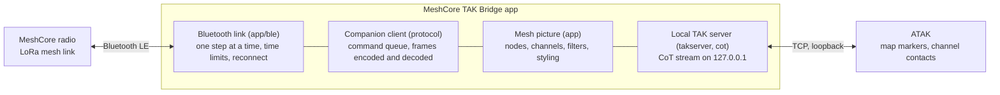

# MeshCore TAK Bridge: Design

First written as a proposal on 11 October 2026. Revised 12 October 2026 to describe the app as built and tested on devices, 13 October 2026 for the move to Colorado Mesh, the connection fixes and the app's branding, 14 October 2026 for the first release, and 17 October 2026 for replies on a channel. Current progress and the to-do list are in [STATUS.md](STATUS.md).

## Summary

MeshCore TAK Bridge is an Android app that connects a phone to a MeshCore companion radio over Bluetooth and presents the mesh to ATAK as a local TAK server. ATAK connects to it the same way it connects to any server. Mesh nodes appear as map markers, and each mesh channel appears as an ATAK contact that carries that channel's chat in both directions.

It is the phone-side counterpart to the TAK server built into the Colorado Mesh desktop client, and the two share their behaviour towards ATAK. What this app learned on devices about chat addressing has been offered back to the desktop client (Colorado-Mesh/mesh-client pull request 1253, awaiting review).

The project was started under Bud's GitHub account and moved into the Colorado Mesh organisation on 13 October 2026, as [Colorado-Mesh/meshcore-tak-bridge](https://github.com/Colorado-Mesh/meshcore-tak-bridge). It is written from scratch, with no code taken from TAK-MESHCORE, and licensed GPL-3.0-or-later, the same as the Colorado Mesh desktop client.

## Background

There were two ways to get MeshCore into ATAK, and each left a gap.

| Option | What it does well | Where it falls short |
| --- | --- | --- |
| Colorado Mesh desktop client, TAK server | One radio serves every ATAK device on the network; channels become chat; nodes become markers | Needs a computer running the client and a shared network, so it does not work for a lone phone in the field |
| TAK-MESHCORE plugin | Phone connects straight to its own radio, no server | See the list below |

Problems seen with the TAK-MESHCORE plugin (v1.5.14), from use and from reading its source:

- It fails to connect on a Samsung Galaxy Tab Active 3 and sits on "Connecting" indefinitely. The connect code starts two Bluetooth operations at once and has no timeout.
- It reads only channel slots 0 to 7, although the radio reports how many it supports.
- It writes its own channel, `ATAK_DATA`, into slot 7 of the radio on every connect, and the channel stays there after disconnect.
- Channel chat lives in a cramped panel inside the plugin, not in ATAK's chat screen.
- It is built for ATAK 5.6.0 only, and an ATAK plugin has to be rebuilt as ATAK changes.
- It has no automated tests in about 36,000 lines of code.

A bridge app avoids the last two by design: it speaks only the standard TAK server protocol, so it is not tied to an ATAK version and needs no plugin signing. The Bluetooth design below answers the first three, and the bridge connects reliably on the Tab Active 3.

## Goals and non-goals

**Goals for version 1**

- Connect reliably to a MeshCore companion radio over Bluetooth on a range of Android devices, including older Samsung tablets.
- Show every mesh node that advertises a position as an ATAK map marker, styled by what it is: companion, repeater, room server or sensor.
- Show every channel on the radio in ATAK's own chat screen, two-way.
- Send and receive plain MeshCore channel text, readable by anyone on the mesh with any MeshCore app.
- Never change the radio's configuration. No channels, contacts, settings or clock are written, and nothing is left behind after disconnect.
- Work with any current ATAK version without being rebuilt.

**Not in version 1**

- Sending ATAK map points, routes or drawings between ATAK users over the mesh. This is what TAK-MESHCORE's `ATAK_DATA` tunnel does, and it is the main source of that plugin's complexity and airtime use.
- Its own encryption layer. MeshCore channels are already encrypted with the channel key.
- Meshtastic or Reticulum support.
- iPhone support. iTAK cannot be served this way from an Android app.
- Anything inside ATAK's interface: no custom tools, menus or buttons. That would need a plugin.

Direct messages with companion nodes were left out of the first pass and added on 12 October 2026 (see "Direct messages" below). Tracking chosen companions by asking them for their position was added on 19 October 2026 (see "Tracking").

## Architecture

The app sits between the radio and ATAK on the same phone, and each part has one job.

Data flows both ways along the same path. Radio frames come in over Bluetooth, are decoded, and update the bridge's picture of nodes and channels; the bridge turns that picture into CoT events for ATAK. A message typed in ATAK to a channel contact travels the other way and leaves the radio as a channel message.

`BridgeService`, a foreground service, owns all of these and holds the only state: the mesh picture, which markers ATAK currently has, and messages waiting for ATAK to connect.

## Radio link

The app talks to the radio with the published [MeshCore companion protocol](https://docs.meshcore.io/companion_protocol/) over Bluetooth Low Energy. The radio exposes a serial-style service with one characteristic the app writes to and one it receives notifications from; each write or notification carries exactly one protocol frame.

### Bluetooth

The Bluetooth layer (`GattLink`) is hand-written against Android's own API rather than built on a library, because the failures it has to avoid are about ordering and time limits, and those are easiest to guarantee directly. Its rules:

- **One step at a time.** Connect, discover services, request a larger packet size (512 bytes), turn on notifications. Each step starts only when the one before it has finished, and outgoing frames are written one at a time.
- **Every step has a time limit.** Connect 12 s per try, discovery 15 s, notifications 10 s, each write 5 s, pairing 60 s.
- **Connecting is tried up to 3 times.** Android, Samsung devices especially, often fails a first connection with status 133, more so straight after a scan stops or while another link to the same radio is still closing. So the link waits 0.6 s before connecting, tries again 1.5 s after a failed try, and gives up only after 3. A replaced link gets a second to close before the next one opens, and choosing the radio already being connected does not start over.
- **The packet size request may go unanswered.** After 4 s the link carries on at the default size rather than waiting. This is where some tablets were seen to stall.
- **Pairing.** When the radio asks for it, Android's PIN prompt appears and the link waits for the result.
- **Choosing a radio.** A scan runs for 12 seconds and lists radios already paired first, since a radio that is connected or asleep may not be advertising. Android quietly ignores an app that starts more than five scans in 30 seconds, so the app counts its starts and says how long to wait. Each radio keeps one button for the whole scan: redrawing the list for every advert, several a second, lost taps.
- **Reconnect.** The chosen radio is remembered by address. A dropped link is retried after 3, 5, 10, 20, 30 and then every 60 seconds, and the last known mesh picture is kept so ATAK's view survives a short gap. The user can disconnect at any time, which stops retries and forgets the radio.

### Companion protocol

The `CompanionClient` in the `protocol` module runs the conversation once the link is ready. Commands wait in a queue, one is outstanding at a time, and each has a 6 s time limit.

1. App start: the reply gives the radio's name and radio settings.
2. Device query: the reply gives the firmware version, model and the number of channel slots.
3. Fetch contacts, then fetch each channel slot up to the number the radio reported (8 for firmware too old to say).
4. Fetch waiting messages, then react to the radio's own "messages waiting" and "advert heard" notices.
5. Read the battery voltage, then again every 5 minutes. Firmware that refuses the request is not asked again.

The client never sets the radio's clock, channels, contacts, paths or settings. Sending channel text, sending a direct message, and asking a tracked companion for its position are the only commands that cause a transmission.

The protocol page is marked as still in development and does not document everything the app uses, such as the contact record layout. Those details come from the MeshCore firmware source, are checked against real radios, and are covered by tests with recorded frames.

### Channel kinds

Each programmed channel is classified by comparing its key with the fixed Public key and with the key a hashtag channel derives from its name (the first 16 bytes of SHA-256 of the name). The classification is kept; the key is not stored anywhere.

### Message length

MeshCore channel text is limited to 160 bytes, and the radio puts its own name and `": "` in front. The bridge works out the room left (at most 133 bytes) and refuses a longer message from ATAK, posting a note in that chat rather than cutting the text. Splitting into parts remains a possible later option.

## Local TAK server

The app runs a small TAK server on the phone that listens only on `127.0.0.1`, port 8087, and ATAK connects to it as a streaming TCP server. Because the connection never leaves the phone, it uses plain TCP with no certificates, which removes the truststore and data-package setup that caused trouble on the desktop client.

The server speaks Cursor on Target (CoT) XML. Each behaviour below was found necessary while testing against ATAK:

- **Bind to 127.0.0.1 explicitly.** Android's `InetAddress.getLoopbackAddress()` is `::1`, and ATAK refused to connect to a server bound there.
- **Bare events.** Each event is sent as an `<event>` element with no XML declaration in front. ATAK parsed the first event on a connection and dropped the rest when a declaration was present.
- **Keepalive replies.** ATAK sends a ping (`t-x-c-t`) when the connection is quiet and redials if nothing comes back. The server answers each with a pong (`t-x-c-t-r`).
- **Marker refresh.** A marker goes stale in ATAK 10 minutes after it was sent, so every current marker is re-sent every 5 minutes, and all of them are sent when ATAK connects.
- **Removal.** A node the filters drop is deleted from ATAK at once with a delete event, rather than left to go stale.
- **One connection.** The server accepts a single client, and the app shows when one is connected.

The bridge learns who the ATAK user is (callsign and uid) from the first position report ATAK sends, because chat is addressed to that user.

ATAK also asks a TAK server's web API on port 8080 for several things each time it connects. With nothing listening, it kept showing "Failed to get server contacts … connection to http://127.0.0.1:8080 refused". Once contacts were answered, it showed "Failed to get server groups … (error 404)" next. The bridge now runs a minimal responder on `127.0.0.1:8080` (`ApiServer`). It answers the requests ATAK makes on its own at connect, each with nothing, in the forms ATAK's open-source code parses:

| Request | Answer |
| --- | --- |
| `GET /Marti/api/clientEndPoints` (server contacts) | `{"type":"com.bbn.marti.remote.ClientEndpoint","data":[]}` |
| `GET /Marti/api/groups/all` (server groups, for ATAK's Channels feature) | `{"type":"com.bbn.marti.remote.groups.Group","data":[]}` |
| `GET /Marti/api/missions` (Data Sync missions, which newer ATAK calls "feeds") | `{"version":"3","type":"Mission","data":[],"nodeId":"meshcore-tak-bridge"}`, TAK Server's own wrapper for the list |
| `GET /Marti/api/missions/all/invitations` (invitations to Data Sync missions; also `/missions/invitations`) | `{"version":"3","type":"MissionInvitation","data":[],"nodeId":"meshcore-tak-bridge"}`, as TAK Server answers it |
| `GET /Marti/api/device/profile/…` (settings profiles) | 204 No Content, which ATAK reads as "nothing new" |
| `GET /Marti/api/version` and `/version/config` | 404; ATAK only logs this, and no error showed on a device |

The contacts and channels themselves still arrive over the CoT stream. The contact-list answer has no `version` field, which is where ATAK reads the server's API version, so the bridge claims no TAK Server features it lacks. (The `version` in the mission list is that list's format version, which TAK Server puts on every mission reply.) The missions request is not in the public 4.x source; it came from the bridge's log on a device ("Failed to get feeds"). The invitations request was found the same way: ATAK showed "Failed to get invitations from all … (404)" for a while after connecting, until a later poll went through. Its answer follows TAK Server's own source (`MissionApi.java`). The other paths in ATAK's code (mission packages, certificate enrollment, CoT history) are used only when the user asks for them. They get 404, and the bridge logs each such path once, so a device test shows whether a newer ATAK wants more. The public ATAK source is version 4.x; the messages above came from a newer ATAK. If another app holds port 8080, the bridge carries on without the responder.

Setting up ATAK is one step: add a server with address `127.0.0.1`, port `8087`, protocol TCP.

## Chat: channels as contacts

The proposal had each channel as a GeoChat room. Testing on devices showed that does not work for replies:

- ATAK only sends chat to a contact it can reach, meaning a contact whose `<contact>` element has an endpoint such as `*:-1:stcp` ("through the server connection").
- ATAK addresses a reply to that contact, not to the room the message was read in. With rooms, the bridge could not tell which channel a reply was for.

So every channel is a contact:

- Its uid is `MESHCORE-CH-<slot>`, with endpoint `*:-1:stcp`. A contact must have a point, so it sits at 0, 0, away from any map in use.
- Its callsign starts with `#` and shows the channel's kind: `#Public`, `#name` for a hashtag channel, and `#🔒 name` for a private channel. ATAK lists contacts alphabetically. `#` sorts before digits and letters, so all channels sit together at the top, ahead of the nodes. The lock sorts after letters, so private channels follow the others within that group. Channels that share a name get their slot number added.
- The bridge posts nothing in a channel's chat until there is a message. The first version posted an opening line from each channel contact on every connect, so the conversation would exist in ATAK. Testing showed a reachable contact is enough to open a chat, and the opening lines marked every channel as unread each time ATAK connected, so they were removed.
- A channel message heard on the mesh arrives as a direct message from that channel's contact to the ATAK user. The mesh sender's name stays in the text, in the `Name: text` form MeshCore uses.
- A message the ATAK user sends to a channel contact is matched to its channel by the contact uid (or, failing that, the callsign) and sent once on that channel, under the radio's own name.
- Messages heard before ATAK connects and identifies itself are held, up to 50, and delivered when it does.
- If the radio is not connected, does not accept the message, or the message is too long, the bridge says so in that chat.

## Direct messages

Direct messages use the same pattern as channels: a contact ATAK can reach stands for each node, and ATAK's reply names that contact.

- **Who can be messaged.** Companion nodes only. A repeater or room server treats plain text from its admin as a command line, so the bridge never sends chat to one, and repeaters and room servers get no endpoint in ATAK.
- **Contacts.** A companion on the map has the `*:-1:stcp` endpoint. A companion with no position, or one the filters hide, becomes a contact at 0, 0 (like a channel) once a direct message has passed with it, so the conversation can go on. That list is cleared when a different radio is chosen.
- **Receiving.** The radio names the sender by the first 6 bytes of its public key. The bridge looks up the full contact and posts the text from that node's contact to the ATAK user. Messages heard before ATAK identifies itself are held with channel messages, up to 50 in all.
- **Duplicates.** When a sender's acknowledgement is lost, the sender tries again with the same timestamp and text. The radio delivers each try, so the bridge drops a repeat of a message from the same sender with the same timestamp and text in the last 15 minutes, and logs it.
- **Sending.** A message to a companion's contact is sent with the companion protocol's send-text command, addressed by the 6-byte key prefix, up to 160 bytes. The radio replies with the code the recipient's acknowledgement will carry and an estimate of how long it should take.
- **Acknowledgement and retries.** If no acknowledgement arrives within that estimate (kept between 2 and 60 seconds) plus 2 seconds, the message is sent again with the same timestamp, up to 3 tries in all. An acknowledgement of any try counts. The MeshCore apps also reset the contact's path before the last try; the bridge does not, because that would write to the radio's contacts.
- **Feedback in ATAK.** When the recipient acknowledges a message, the bridge sends ATAK a delivery receipt (`b-t-f-d`), and ATAK shows its message as delivered. The receipt is built like ATAK's own (`GeoChatService.sendStatusMessage` in ATAK's source): its event uid is ATAK's id for the message, which the bridge reads from the chat ATAK sent (`__chat messageId`, or the end of the event uid) and keeps until the radio reports the outcome, for up to 100 messages at once. No acknowledgement after 3 tries, or a refusal by the radio (for example, a node it does not know), puts a note in that conversation instead. Channel messages get no receipt: MeshCore floods them without acknowledgement.

Room server posts arrive as signed messages and are skipped. The radio's log says so once per connection.

## Replies on a channel

MeshCore has no reply-to-message feature. Its apps start a reply with `@[Name]`, and the firmware sends that like any other channel text, so a reply is a convention between apps. ATAK's chat has no reply action, and adding one would need a plugin. So a reply is typed in the channel's chat, and the bridge writes it in MeshCore's form:

| Typed in ATAK | Sent on the channel |
| --- | --- |
| `@silver are you on?` | `@[Silver Eagle] are you on?`, when exactly one recent sender's name starts with "silver" |
| `@"Silver Eagle" ok` | `@[Silver Eagle] ok`: a whole name, spaces included |
| `@@ thanks` | `@[<whoever spoke last on this channel>] thanks` |
| `@home in 10`, with no one called Home | `@home in 10`, unchanged |
| `@[Silver Eagle] hi` | unchanged |

- **Matching** ignores case, spaces, emoji and punctuation, since names such as `🔥 W0RMT 03` are hard to type exactly. A name that matches exactly wins over longer names it starts.
- **Nothing is sent by guesswork.** When several names match, or `@@` is used on a quiet channel, nothing goes out, and a note in that chat says why, listing up to five matching names.
- **Who can be replied to:** senders heard on that channel in the last 24 hours, up to 50 per channel, read from MeshCore's `Name: text` form as messages arrive and timed by the phone's clock, not the sender's. The radio's own name is never one of them. The list is cleared when a different radio is chosen.
- **The length limit** applies to the text as sent, `@[Name]` included.

Per-person reply contacts in ATAK were considered, since they would need no typing, but on a busy mesh they would crowd the contact list. Received replies are shown as they arrive, `@[Name]` and all.

## Radio battery

The radio reports its battery only as a voltage, in answer to a request; it sends no low-battery notice of its own. The bridge reads it at connect and every 5 minutes, and turns it into an approximate percentage using the discharge curve of a typical lithium-ion cell (4.19 V full, 3.27 V empty). It is shown as "about", since the voltage reads high while charging and sags while transmitting. It reads lower than the MeshCore app near empty, since that app scales evenly from 3.0 V to 4.2 V (see "Open questions and risks"). A reading of 0 means the board cannot measure its battery.

The reading appears on the bridge's screen and in its notification. As it falls to 20% and to 10%, a heads-up alert appears over ATAK; each level alerts once, and again only after the battery has climbed 5 points above it.

ATAK itself shows nothing. The radio is not on the map (the user's own marker is the phone), ATAK's battery field belongs to position reports, and a note in each channel's chat would mark every channel unread. A "Bridge" contact for radio notices was considered and set aside, to keep the contact list short.

## Tracking

Adverts carry a position, but a companion adverts only when its owner triggers it, so markers placed from adverts rarely move. For people who have agreed to be followed, the bridge asks instead.

- **Choosing whom:** up to 10 companions, ticked on the bridge's screen; the list is the radio's companion contacts. ATAK has no menu the bridge could add a "track" choice to without a plugin.
- **Asking:** MeshCore's telemetry request (`CMD_SEND_TELEMETRY_REQ`, 39) to each in turn, about every 5 minutes (2 to 30 can be chosen, 1 minute at the least), and only while ATAK is connected. The radio keeps track of one such request at a time, so the next is sent only when the last has been answered or has timed out (the radio's own estimate, plus 2 s).
- **The answer:** `PUSH_CODE_TELEMETRY_RESPONSE` (0x8B), carrying the node's key prefix and its telemetry in Cayenne LPP form. The bridge reads the node's own battery voltage and GPS entry (channel 1; latitude and longitude in units of 0.0001°, about 11 m) and stops at any type whose size it does not know. A node includes its position only when its GPS is on and its owner allows location telemetry for everyone or for the asking radio (`TELEM_MODE_ALLOW_ALL`, or `ALLOW_FLAGS` with the location flag on this radio's contact). A request it does not allow gets no answer at all, so "no answer" can mean either refused or out of range. It also answers only when its "base" telemetry permission is allowed, and only for a contact it knows with a current key: an out-of-date contact for this radio gives "no answer" every time, as with direct messages (seen on 19 October 2026; an advert from each radio fixed it).
- **On the map:** the marker moves to the reported position when that is newer than the node's advert, and a tracked node shows even when the type or age filters would hide it. ATAK draws tracks for moving contacts itself, so the bridge draws none. Altitude is left out: MeshCore's GPS altitude is most likely height above sea level, while CoT's `hae` is height above the ellipsoid, about 17 m different around Denver.
- **On the screen:** a line per tracked node, with its last position and time, or why there is none. The log notes only changes.

## Echoes

A channel message sent from ATAK should never come back to ATAK. The firmware marks each packet it floods as already seen, so a repeater's rebroadcast is dropped, and sending a channel message produces no received-message frame. The bridge still checks. A received channel message with the same channel and text as one it sent in the last 15 minutes (`"<radio name>: <text>"`, the form the radio transmits) is dropped and logged as an echo, so a device test can show whether it ever happens. The check could also drop an identical message from a different node with the same name as this radio. That is unlikely, and it is logged.

## Data mapping

| On the mesh | In ATAK | Notes |
| --- | --- | --- |
| Companion node with a position | Team member marker (`a-f-G-U-C`), reachable for chat | Team colour chosen in the app, default Cyan; callsign is the node name |
| Companion node off the map, after a direct message | Team member contact at 0, 0, reachable for chat | Keeps the conversation going |
| Repeater with a position | Installation marker (`a-f-G-I`) | Optional icon from an ATAK icon set (GeoOps presets offered) |
| Room server with a position | Installation marker (`a-f-G-I`) | Its own optional icon, separate from repeaters |
| Sensor node with a position | Sensor marker (`a-f-G-E-S`) | |
| Node without a position | Not shown | MeshCore nodes only share location if set to |
| Channel on the radio | Contact, with a chat | See "Chat: channels as contacts" |
| Channel message heard | Message from that channel's contact | Sender's name kept in the text |
| Message sent to a channel contact in ATAK | Channel message from this radio | Goes out under the radio's own name |
| `@name …` or `@@ …` sent to a channel contact | Channel message starting `@[Name]` | MeshCore's reply form; see "Replies on a channel" |
| Direct message heard | Message from that node's contact | |
| Message sent to a companion's contact in ATAK | Direct message to that node | Acknowledged, or tried up to 3 times |
| The node's acknowledgement | Delivery receipt (`b-t-f-d`) for that message | ATAK shows it as delivered |

**Markers.** Each node's uid is built from its MeshCore public key (`MESHCORE-` and the first 16 hex digits), so it keeps its marker across restarts. The remarks give the node kind and its last advert time.

**Filters.** The user chooses which node types appear and how old a node's last advert may be (default: hide nodes not heard for 7 days). An advert dated in the future, from a sender with a wrong clock, counts as fresh. Changing a filter updates ATAK at once.

**Icons.** An icon is given as `<icon set uid>/<group>/<file>`. ATAK draws the standard symbol if it does not have the icon set. Paths are checked so they cannot break out of the XML attribute.

**Own position.** ATAK already shows the phone's own position, so the bridge does not create a marker for the user's own radio.

## Security and privacy

The app's exposure is small because nothing leaves the phone except what the radio transmits.

- **Loopback only.** The TAK server binds to `127.0.0.1`, and so does the web API responder on port 8080, so no other device on a network can reach either. The responder holds no data: it only ever answers with an empty contact list. Other apps on the same phone can, which is why the server accepts a single client and the app shows when one is connected.
- **Transmitting is the user's own act.** Only messages the user sends to a channel or companion contact are transmitted, from the user's own radio, plus position requests to companions the user chose to track, while ATAK is connected. Retries of an unacknowledged direct message stop after 3 tries; position requests are capped at 10 nodes and at most one a minute each.
- **Location only by consent.** A node answers a position request only when its owner has allowed base and location telemetry, for everyone or for this radio; otherwise it sends nothing back. Positions are kept in memory to place markers and are never stored or passed on beyond the ATAK on the same phone.
- **No commands to infrastructure.** Chat is never sent to a repeater or room server, which could read it as an admin command.
- **No configuration writes.** The app cannot alter channels, keys, contacts, the clock or radio settings. Channel keys are read only to classify the channel and are not kept.
- **Untrusted input.** Everything from the radio and from ATAK is parsed defensively with length limits, and outgoing events are built from parsed fields with XML escaping, never by passing text through.
- **Rate limit.** At most 10 chat messages a minute are accepted from ATAK, and at most 5 can wait to be sent, so a misbehaving client cannot flood a slow shared channel.
- **Permissions.** Bluetooth connect and scan, notifications, and foreground service. Location is requested only on Android 11 and older, where Bluetooth scanning requires it. Android requires the internet permission for any network socket, including a loopback one, so the app declares it but makes no outside connections.
- **No analytics.** The app reports nothing about its use and connects to nothing beyond loopback. (MeshCore's telemetry requests, used for tracking, go over the mesh to nodes the user chose.)

## Technology and repository layout

The app is written in Kotlin, split so that most of the logic is plain code with no Android dependency and can be tested on any computer.

| Module | Contents | Depends on Android |
| --- | --- | --- |
| `protocol` | MeshCore companion frames, and the client that runs the command queue | No |
| `cot` | Build and parse CoT events: markers, contacts, GeoChat, deletes, ping and pong; stream framing | No |
| `takserver` | Loopback TCP server, inbound chat, rate limit; minimal web API answer on port 8080 | No |
| `app` | Bluetooth link and scanner (`ble/`), the mesh picture, the foreground service, the status and settings screen | Yes |

The proposal had separate `bridge` and `ble` modules. In practice the mapping (`MeshPicture`) and the Bluetooth code sit in `app`; the mapping could move into a plain module if it grows tests of its own.

Other choices:

- **Android versions:** Android 8 (API 26) or later, targeting API 34.
- **Background running:** a foreground service with a persistent notification. The Tab Active 3 held the radio link overnight without being stopped by power saving.
- **Interface:** built in code, with no layout resources. The screen opens with a Colorado Mesh header (navy, the app icon, name and version, over a red-to-yellow line like the logo's arc) and ends with an About section linking to the source code and coloradomesh.org.
- **Icon:** an adaptive icon, with a themed version and a matching status bar icon: the Colorado Mesh mark, its arc closed into a map crosshair, in the Colorado Mesh colours. It uses no ATAK or TAK artwork, since the project is not affiliated with the TAK Product Center. `docs/icon/make_icon.py` writes the vector drawables and a preview from one description.
- **Application ID:** `org.coloradomesh.takbridge`, from the organisation's domain; the Kotlin packages share it.
- **Licence:** GPL-3.0-or-later, matching the Colorado Mesh desktop client.
- **Builds:** changes arrive by pull request. Each pull request and each push to `main` runs the tests and builds a debug APK in GitHub Actions; CodeQL also checks each pull request. A version tag (`v0.1.0`) runs the release workflow, which signs the APK with the release key and drafts a GitHub Release ([RELEASING.md](RELEASING.md)).

## Testing

- **Unit tests.** `protocol` is tested with recorded byte frames and a scripted radio for the client's command queue; `cot` with expected events and parsing of what ATAK sends; `takserver` with a scripted client that connects, pings and exchanges chat.
- **On-device checks.** Bluetooth and ATAK behaviour are checked by hand on a Pixel 9 Pro and a Galaxy Tab Active 3.

Not yet in place: a simulated radio that runs the whole bridge end to end on a computer, and a written on-device test script for releases.

## Development plan

| Milestone | State |
| --- | --- |
| 0. Repository, build, tests on every change | Done |
| 1. ATAK spike: loopback TAK server with demo data | Done; ATAK accepts plain TCP on `127.0.0.1` |
| 2. Bluetooth spike | Done on both test devices, including reconnect |
| 3. Protocol | Done for what version 1 needs |
| 4. Nodes on the map | Done, with type and age filters, team colour and icons |
| 5. Channel chat | Done, with channels as contacts |
| 5a. Direct messages and echo check | Done; direct messages tested both ways, no channel echoes seen |
| 6. App shell | Done: radio picker, connection status, map settings, background service, Colorado Mesh header, icon and About |
| 7. Field test and first release | Done: version 0.1.0 released 14 October 2026, signed with the Colorado Mesh release key; 0.1.1 followed on 17 October |

Later candidates, in rough order: room server posts, splitting long messages, and sharing the phone's position to the mesh.

## Open questions and risks

Settled by testing on devices:

- [x] **Does ATAK accept a plain TCP server on loopback?** Yes, when bound to `127.0.0.1` rather than `::1`.
- [x] **How does ATAK address a reply?** To a reachable contact, not to a room; hence channels as contacts.
- [x] **Will Android keep the bridge running?** Yes on both test devices, including overnight on the Tab Active 3.
- [x] **Does pairing work across devices?** Yes on both test devices, with the PIN prompt and the packet size request allowed to go unanswered.
- [x] **Does choosing a radio connect on the first tap?** Yes, on build #43 (13 October 2026), after the scan list stopped redrawing under the user's finger. See "Choosing a radio" above.
- [x] **What is the application ID?** `org.coloradomesh.takbridge`, from the Colorado Mesh organisation's own domain, decided on 13 October 2026. It replaced `io.github.robertmtalbot.takbridge` before the first signed release, and the Kotlin packages use the same name. It must not change again, because Android treats a new ID as a different app.
- [x] **Does a sent channel message ever come back, so that it shows twice in ATAK?** No. The firmware source says not (see "Echoes"), and the bridge's echo log never fired in testing on 12 October 2026. The guard stays as a safety net.
- [x] **Do ATAK's delivery receipts work through this server?** Yes, checked on 19 October 2026: ATAK puts a check mark beside the time of the latest message sent in that conversation once the mesh acknowledges it.
- [x] **Does the battery estimate match what MeshCore's own apps show?** Not exactly, by design. At 3.88 V the bridge showed 69% and the MeshCore app 73% (19 October 2026); the MeshCore app appears to scale evenly from 3.0 V to 4.2 V. The bridge keeps the lithium curve, which reads lower near empty (about 20% against 42% at 3.5 V) and so gives its low-battery alerts in time.
- [x] **Who keeps the release signing key?** Bud creates and holds it (decided 14 October 2026), with a password-manager copy and an offline copy. GitHub keeps it as secrets in a `release` environment that a maintainer must approve each run to use. Every release must be signed with this key, or installed copies cannot update. See [RELEASING.md](RELEASING.md).

Still open:

- [ ] **Which undocumented protocol details are stable?** The contact record and advert layouts come from firmware source, not the published page, and may change between firmware versions.
- [ ] **Should the phone's position be shared to the mesh?** It would mean writing the radio's advertised location, which conflicts with the rule of never changing radio settings.

Decided on 11 October 2026: the name is MeshCore TAK Bridge, and the licence is GPL-3.0-or-later.
